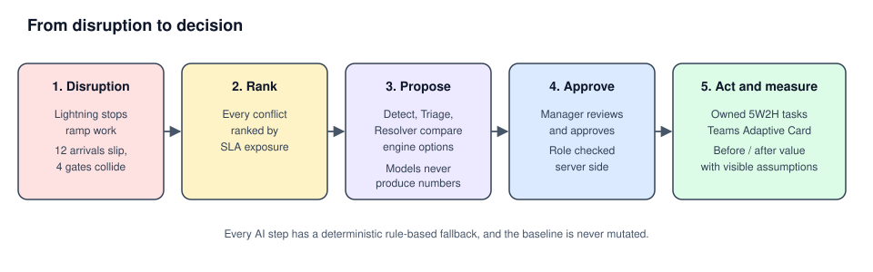
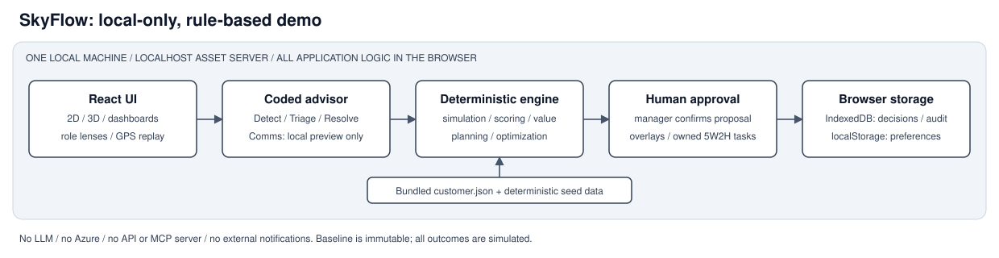

# AI Operations Control Tower

[](https://github.com/dahatake/SkyFlow-AI/actions/workflows/ci.yml)
[](https://github.com/dahatake/SkyFlow-AI/actions/workflows/codeql.yml)
[](LICENSE)


[Overview](#overview) · [Quick start](#quick-start) · [Tutorial](#tutorial) · [Architecture](#architecture) · [Repository map](#repository-map) · [Deploy](#deploy-to-azure) · [Contributing](#contributing) · [License](#license)

## Overview

**One real-time view of ground operations, with agents that propose the fix and a person who approves it.**

When lightning stops ramp work, 12 arrivals slip and 4 gates collide. Today the duty team finds that through radios, chat and several screens. This control tower ranks every conflict by SLA exposure, lets an agent pipeline compare the options with a deterministic scenario engine, asks a manager to approve, and turns the decision into owned 5W2H tasks. It then shows what the decision saved, with the assumptions visible.

Reference customer: SATS (Project SPEAR) at Singapore Changi. A second sample customer (`generic-hub`) proves the same repo can be re-targeted.



| Step | What the viewer sees | Screenshot |
|---|---|---|
| 1. Problem | Disruption and what is wrong |  |
| 2. Proposal | Detect, Triage and Resolve agents propose options |  |
| 3. Approval and tasks | Person approves, tasks get owners |  |
| 4. Value | Before and after, simulated, with assumptions |  |

### Features

- Conflicts ranked by SLA exposure in a 3D/2D operations view
- Four-agent pipeline (Detect, Triage, Resolver, Comms) over a deterministic engine exposed through MCP
- Human approval gate with server-side role checks and an audit trail
- 5W2H task generation and a simulated before/after value model
- Multi-language UI (en, zh, ko, ja) and Playwright accessibility tests
- Customer-agnostic: re-target via one `customer.json`

## Quick start

Prerequisites: Node.js 22+ (see `app/.nvmrc`). Python 3.12 is only needed for `services/agent-api`. No Azure subscription is required.

```powershell
git clone https://github.com/dahatake/SkyFlow-AI.git
cd SkyFlow-AI
./scripts/setup.ps1        # Linux/macOS: ./scripts/setup.sh
cd app
npm run dev                # http://localhost:5173
```

Reproducible demo: <http://localhost:5173/?clock=2027-01-11T08:00:00%2B08:00&demo=1>. The agent features fall back to a deterministic rule-based advisor when no agent service is configured, so the demo never depends on the network.

## Tutorial

A guided walk-through of the demo, then the agent service, then your own customer.

### 1. Run the demo

```powershell
cd app
npm run dev
```

Open <http://localhost:5173/?clock=2027-01-11T08:00:00%2B08:00&demo=1>. The `clock` parameter freezes time so every run is identical.

### 2. Follow the decision flow

1. **Problem**: read the disruption summary and the ranked conflicts.
2. **Proposal**: open the agent proposal. Detect, Triage and Resolver list engine-computed options with their trade-offs.
3. **Approval and tasks**: approve one option. Owned 5W2H tasks appear.
4. **Value**: open the value view to compare before and after, with the assumptions shown.

### 3. Run the agent service (optional)

```powershell
cd services/engine-mcp; npm ci; npm start          # MCP tools on :8080
cd ../agent-api
python -m venv .venv; .\.venv\Scripts\Activate.ps1
pip install -e ".[dev]"
$env:AUTH_DISABLED='true'; $env:ENGINE_MCP_URL='http://localhost:8080/mcp'
uvicorn agent_api.app:create_app --factory --port 8000
```

With no model configured the service runs in `rules` mode. Details: [agent-api](services/agent-api/README.md), [engine-mcp](services/engine-mcp/README.md).

### 4. Bring your own customer

1. Copy `app/src/customers/generic-hub` to `app/src/customers/<id>`.
2. Edit `customer.json` (names, airport, currency, assumptions with a source).
3. Register it in `app/src/customers/index.ts`.
4. Run `npm run validate:customer -- <id>`, then open `?customer=<id>`.

The full path to a deployed demo is in the [PLAYBOOK](docs/PLAYBOOK.md); a talk track is in [DEMO-SCRIPT](docs/DEMO-SCRIPT.md).

## Architecture



Design rules:

1. **The engine is the source of truth.** Models only choose among options the engine computed. They never produce numbers.
2. **Agents propose, people approve.** Nothing is applied without an approval, and the baseline is never mutated.
3. **Every AI path has a deterministic fallback.** Same input gives the same output.

## Repository map

| Path | What it is |
|---|---|
| `app/` | React + TypeScript UI, the pure domain engine (`src/domain`), tests, Playwright e2e, deck sources |
| `app/src/customers/<id>/customer.json` | Everything customer specific: names, airport, assumptions, dates |
| `services/engine-mcp/` | The engine exposed as MCP tools |
| `services/agent-api/` | Multi-agent pipeline, approval gate, audit, Teams card |
| `infra/` | Bicep for the whole platform (`azd up`) |
| `docs/` | Requirements, narrative, [PLAYBOOK](docs/PLAYBOOK.md), [DEMO-SCRIPT](docs/DEMO-SCRIPT.md), [VALUE-MODEL](docs/VALUE-MODEL.md) |
| `.github/` | CI/CD, plus Copilot instructions, agents, skills and prompts for AI-driven reuse |

## Reuse it for another engagement

Open the repo in VS Code with Copilot and run the prompt `/instantiate-engagement` (see [PLAYBOOK](docs/PLAYBOOK.md)). It uses the `customer-onboarding` agent and the `swap-customer-dataset`, `generate-deck` and `deploy-azure` skills.

## Commands

| Task | Command (from `app/`) |
|---|---|
| Unit tests | `npm test` (coverage gate: `npm run test:coverage`) |
| End-to-end and accessibility | `npm run test:e2e` |
| Lint | `npm run lint` |
| Validate customer files | `npm run validate:customer` |
| Decks to PDF | `npm run build:deck -- <customerId>` |
| Deploy | `azd up` after `./scripts/preflight.ps1` |

## Deploy to Azure

These steps deploy the full platform: the Static Web App, engine and agent containers, scheduler job, Microsoft Foundry models, Cosmos DB, Key Vault, and monitoring. Azure resources incur charges.

### 1. Install prerequisites and sign in

- [Node.js 22+](https://nodejs.org/) and [Git](https://git-scm.com/downloads).
- [Azure CLI](https://learn.microsoft.com/cli/azure/install-azure-cli) with Bicep, and [Azure Developer CLI (`azd`)](https://learn.microsoft.com/azure/developer/azure-developer-cli/install-azd).
- An Azure subscription with permission to create resources and role assignments at subscription scope (for example, Contributor plus User Access Administrator), and quota for the selected Foundry models.

Run the following PowerShell commands from the repository root. If you have not cloned the repository yet, follow [Quick start](#quick-start) first.

```powershell
az login
azd auth login
az bicep install
```

### 2. Configure a deployment environment

Replace the subscription ID and budget email below. Use a distinct environment name for each deployment; it determines the resource group name (`rg-<environment-name>`).

```powershell
$subscriptionId = '<your-subscription-id>'
$location = 'eastasia'
$foundryLocation = 'eastus2'

az account set --subscription $subscriptionId
azd env new skyflow-dev
azd env set AZURE_SUBSCRIPTION_ID $subscriptionId
azd env set AZURE_LOCATION $location
azd env set FOUNDRY_LOCATION $foundryLocation
azd env set COSMOS_LOCATION southeastasia
azd env set ENVIRONMENT_TYPE dev
azd env set BUDGET_CONTACT_EMAIL '<your-budget-alert-email>'
```

Defaults are defined in [infra/main.parameters.json](infra/main.parameters.json):

| Setting | Default | When to change it |
|---|---|---|
| `AZURE_LOCATION` | `eastasia` | Choose a region supporting Static Web Apps and Container Apps |
| `FOUNDRY_LOCATION` | `eastus2` | Choose a region offering the models with sufficient quota |
| `COSMOS_LOCATION` | `southeastasia` | Choose a region with Cosmos DB capacity |
| `FOUNDRY_MODEL_PRIMARY` / `FOUNDRY_MODEL_FAST` | `gpt-4.1` / `gpt-4.1-mini` | Match available models, versions, SKUs, and capacity |
| `ENVIRONMENT_TYPE` | `dev` | Use `staging` or `prod`; prod keeps container replicas running |
| `SWA_SKU` | `Standard` | Required for the default linked `/api/*` backend |

Set overrides with `azd env set <SETTING> <VALUE>`. The subscription budget defaults to **10,000 USD/month**; it sends alerts, not a spending cap. Adjust `monthlyBudgetUsd` in [infra/main.parameters.json](infra/main.parameters.json) before provisioning if needed.

**Authentication:** the website requires Microsoft Entra sign-in by default, but the infrastructure sets API token validation to disabled when `API_AUDIENCE` is empty (`AUTH_DISABLED=auto`). Treat this default as demo-only. Before production use, configure Entra bearer-token access, set `API_AUDIENCE` and `AUTH_DISABLED=false`, and verify client token handling and approver roles. See [agent-api authentication](services/agent-api/README.md#environment). Azure service access uses managed identity; never commit credentials or the ignored `.azure/` directory.

### 3. Check prerequisites, preview, and deploy

```powershell
.\scripts\preflight.ps1 -SubscriptionId $subscriptionId -Location $location -FoundryLocation $foundryLocation
# Stop here if any checks fail; apply the printed fixes and rerun.
azd provision --preview
# Review the proposed resources and costs before continuing.
azd up
```

On Linux/macOS, install `jq` and run `AZURE_LOCATION=eastasia FOUNDRY_LOCATION=eastus2 ./scripts/preflight.sh <your-subscription-id>` instead, substituting your selected regions. If you override model settings, pass matching model, SKU, and capacity options to PowerShell preflight (or export the corresponding environment variables for either script); `azd env set` does not export them into your shell.

`azd up` provisions the Bicep infrastructure in [infra/](infra/) and deploys the services in [azure.yaml](azure.yaml). Container images use remote builds in Azure Container Registry, so local Docker is not required.

### 4. Verify the deployment

```powershell
$webUri = azd env get-value WEB_URI
$apiUri = azd env get-value API_URI
Invoke-RestMethod "$($apiUri.TrimEnd('/'))/health"
Invoke-RestMethod "$($webUri.TrimEnd('/'))/api/health"
```

Both health requests should succeed. Open the `WEB_URI` URL, sign in, and follow the [decision flow](#2-follow-the-decision-flow) to check proposals, approvals, and tasks. A healthy API alone does not prove model-backed proposals work: `/health` reports whether a model is configured, and the pipeline can still use its deterministic fallback.

### 5. Update or automate deployments

```powershell
azd env select skyflow-dev
azd deploy                 # Application changes only
# For infrastructure or provisioning-setting changes, preview and run azd up again.
```

For GitHub Actions, create `staging` and `production` GitHub environments, with required reviewers for production. Run [scripts/setup-oidc.ps1](scripts/setup-oidc.ps1) once per environment:

```powershell
.\scripts\setup-oidc.ps1 -SubscriptionId $subscriptionId -Repo '<owner>/<repo>' -Environment staging
.\scripts\setup-oidc.ps1 -SubscriptionId $subscriptionId -Repo '<owner>/<repo>' -Environment production
```

Set the printed variables in each GitHub environment, using distinct `AZURE_ENV_NAME` values. [CD](.github/workflows/cd.yml) deploys staging, smoke-tests it, then deploys production. See the [PLAYBOOK](docs/PLAYBOOK.md#5-cicd-15-min) for variables and rollback instructions.

### 6. Remove a deployment

Select the environment carefully: this deletes its deployed resources and data.

```powershell
azd env select skyflow-dev
azd down --purge
```

Key Vault purge protection is enabled by default; protected vaults cannot be immediately purged. Use a new environment name if a retained vault causes a redeployment conflict. For region, model quota, and sign-in issues, see [troubleshooting](docs/PLAYBOOK.md#troubleshooting).

## Contributing

Issues and pull requests are welcome. Before opening a PR, run `npm test`, `npm run lint` and `npx tsc --noEmit` in `app/`. Read [AGENTS.md](AGENTS.md) for the hard rules (engine is the source of truth, human approval gate, deterministic fallback, no secrets, every UI string through `tr()`).

## License

[MIT](LICENSE) © 2026 Daiyu Hatakeyama

## Status and honesty

Data is synthetic. Value figures are simulation output combined with assumptions in `customer.json`, and the UI says so. Replace the assumptions with validated customer numbers before external use.
