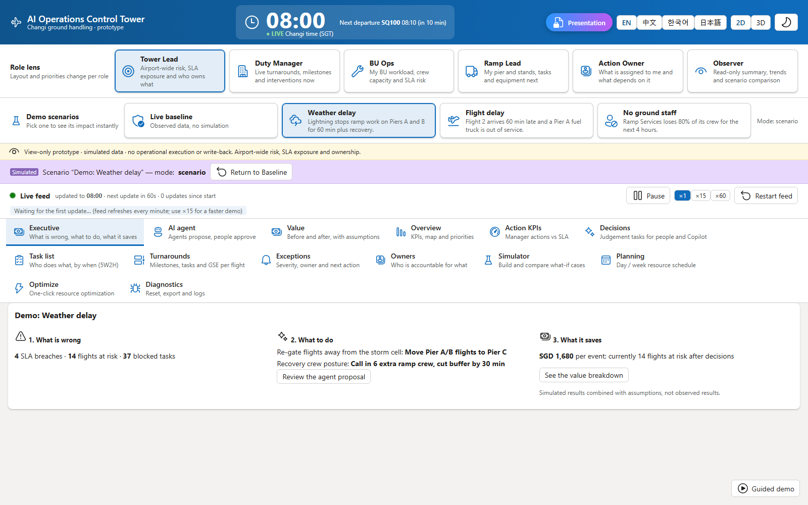
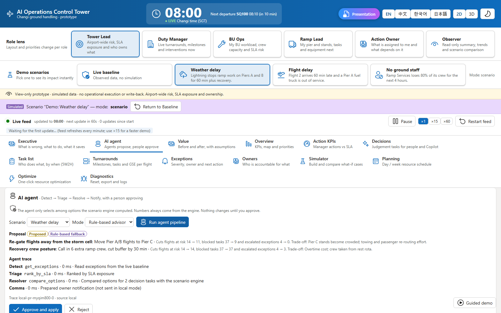
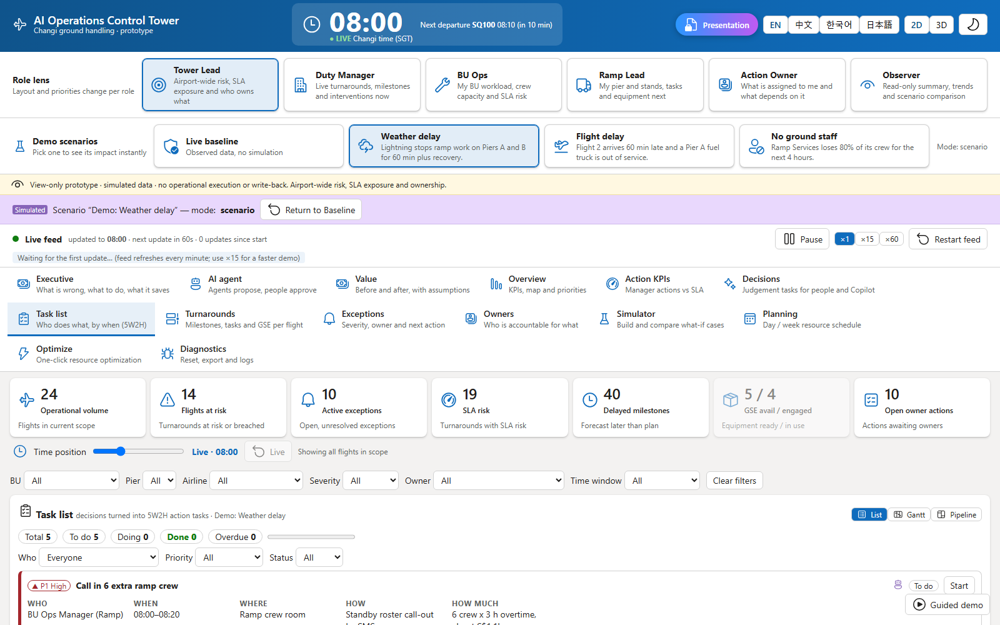
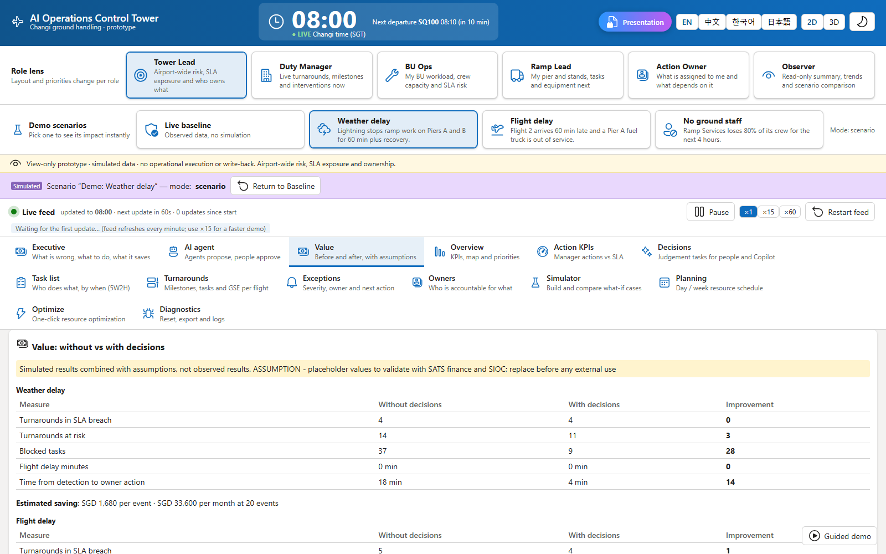
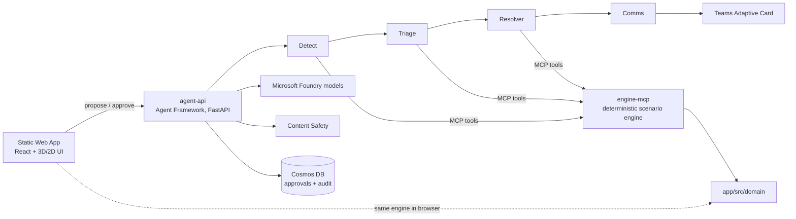

# AI Operations Control Tower

**One real-time view of ground operations, with agents that propose the fix and a person who approves it.**

When lightning stops ramp work, 12 arrivals slip and 4 gates collide. Today the duty team finds that through radios, chat and several screens. This control tower ranks every conflict by SLA exposure, lets an agent pipeline compare the options with a deterministic scenario engine, asks a manager to approve, and turns the decision into owned 5W2H tasks. It then shows what the decision saved, with the assumptions visible.

Reference customer: SATS (Project SPEAR) at Singapore Changi. A second sample customer (`generic-hub`) proves the same repo can be re-targeted.

| Step | What the viewer sees | Screenshot |
|---|---|---|
| 1. Problem | Disruption and what is wrong |  |
| 2. Proposal | Detect, Triage and Resolve agents propose options |  |
| 3. Approval and tasks | Person approves, tasks get owners |  |
| 4. Value | Before and after, simulated, with assumptions |  |

## Quick start (about 5 minutes, no Azure needed)

```powershell
git clone https://github.com/dahatake/SkyFlow-AI.git
cd SkyFlow-AI
./scripts/setup.ps1        # Linux/macOS: ./scripts/setup.sh
cd app
npm run dev                # http://localhost:5173
```

Reproducible demo: <http://localhost:5173/?clock=2027-01-11T08:00:00%2B08:00&demo=1>. The agent features fall back to a deterministic rule-based advisor when no agent service is configured, so the demo never depends on the network.

## How it fits together



Design rules:

1. **The engine is the source of truth.** Models only choose among options the engine computed. They never produce numbers.
2. **Agents propose, people approve.** Nothing is applied without an approval, and the baseline is never mutated.
3. **Every AI path has a deterministic fallback.** Same input gives the same output.

## Repository map

| Path | What it is |
|---|---|
| `app/` | React + TypeScript UI, the pure domain engine (`src/domain`), tests, Playwright e2e, deck sources |
| `app/src/customers/<id>/customer.json` | Everything customer specific: names, airport, assumptions, dates |
| `services/engine-mcp/` | The engine exposed as MCP tools |
| `services/agent-api/` | Multi-agent pipeline, approval gate, audit, Teams card |
| `infra/` | Bicep for the whole platform (`azd up`) |
| `docs/` | Requirements, narrative, [PLAYBOOK](docs/PLAYBOOK.md), [DEMO-SCRIPT](docs/DEMO-SCRIPT.md), [VALUE-MODEL](docs/VALUE-MODEL.md) |
| `.github/` | CI/CD, plus Copilot instructions, agents, skills and prompts for AI-driven reuse |

## Reuse it for another engagement

Open the repo in VS Code with Copilot and run the prompt `/instantiate-engagement` (see [PLAYBOOK](docs/PLAYBOOK.md)). It uses the `customer-onboarding` agent and the `swap-customer-dataset`, `generate-deck` and `deploy-azure` skills.

## Commands

| Task | Command (from `app/`) |
|---|---|
| Unit tests | `npm test` (coverage gate: `npm run test:coverage`) |
| End-to-end and accessibility | `npm run test:e2e` |
| Lint | `npm run lint` |
| Validate customer files | `npm run validate:customer` |
| Decks to PDF | `npm run build:deck -- <customerId>` |
| Deploy | `azd up` after `./scripts/preflight.ps1` |

## Status and honesty

Data is synthetic. Value figures are simulation output combined with assumptions in `customer.json`, and the UI says so. Replace the assumptions with validated customer numbers before external use.
