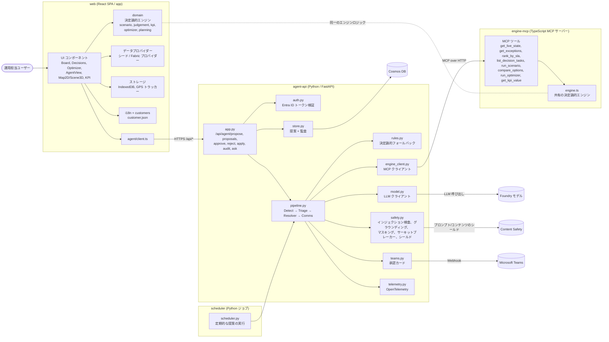
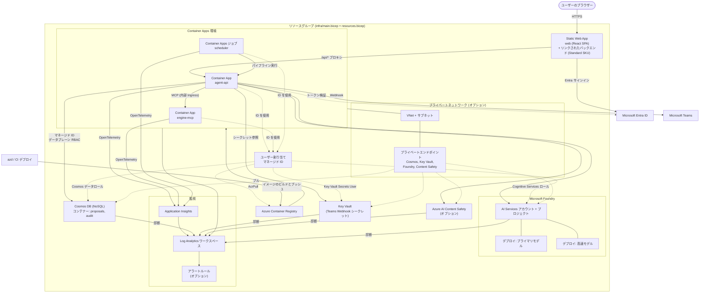

# システムコンポーネント図

SkyFlow-AI のアプリケーション層コンポーネント図と Azure コンポーネント図です。
(出典: [azure.yaml](../azure.yaml)、[infra/resources.bicep](../infra/resources.bicep)、`app/`、`services/`)

## 1. アプリケーション層

## 2. Azure コンポーネント

## 補足

- `agent-api` と `scheduler` は同じイメージ/プロジェクト (`services/agent-api`) からビルドされます。scheduler は Container Apps ジョブとして実行されます。
- 数値の唯一の情報源は決定論的エンジンです。LLM は選択と説明のみを行い、`safety.py` のグラウンディング検査で保護されます。
- プライベートエンドポイント、Content Safety、アラート、SWA のリンクされたバックエンドは、Bicep パラメーター (`enablePrivateNetworking`、`enableContentSafety`、`enableAlerts`、`linkSwaBackend`) によって有効化される条件付きの構成です。
