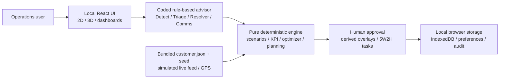
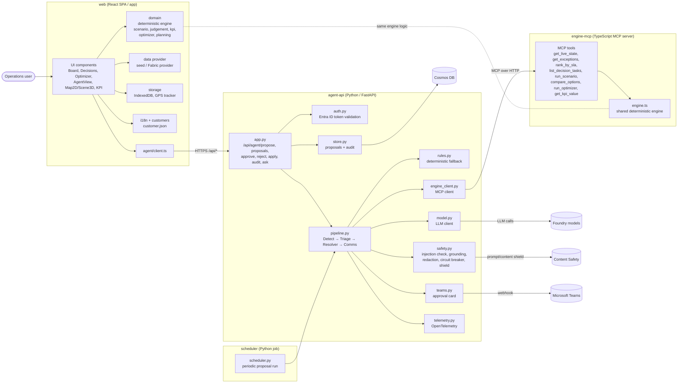
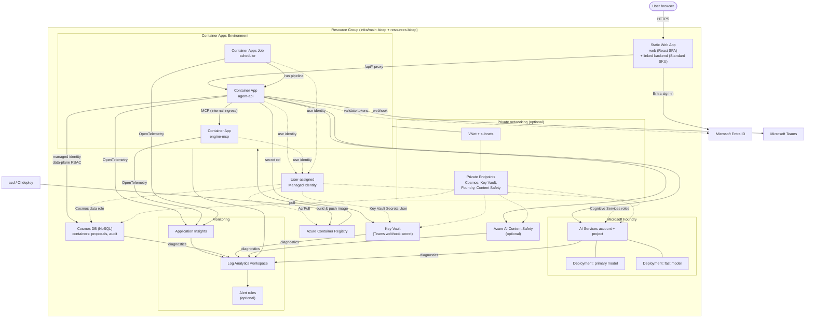

# System Component Diagram

## Current system: local-only horizontal demo

Everything runs on one local machine. Vite serves bundled assets on localhost; the browser executes all application logic. No LLM, MCP/API server, Azure, Entra sign-in, Fabric feed, Teams webhook or telemetry endpoint is used. Rules select valid engine options and compute explanations from scores. Comms records a local notification preview only.

The approval gate remains explicit; only the three manager roles can approve pipeline proposals. These are local demo role checks, not production authentication. Decisions and audit persist in IndexedDB; preferences use localStorage. Baseline records remain immutable. Dependencies need installation once; afterwards only the localhost server is needed (no PWA/service worker).

Implementation: [advisor](../app/src/agent/client.ts), [approval UI](../app/src/components/AgentView.tsx), [engine](../app/src/domain), [storage](../app/src/storage), [seed provider](../app/src/data/provider.ts).

## Archived cloud architecture (not running in the demo)

Historical Azure and LLM components

The diagrams below describe the retired cloud implementation, not the current runtime.
(Sources: [azure.yaml](../azure.yaml), [infra/resources.bicep](../infra/resources.bicep), `app/`, `services/`)

## 1. Application layer

## 2. Azure components

## Notes

- `agent-api` and `scheduler` are built from the same image/project (`services/agent-api`); the scheduler runs as a Container Apps Job.
- The deterministic engine is the sole source of numbers; the LLM only selects/explains and is guarded by grounding checks in `safety.py`.
- Private endpoints, Content Safety, alerts, and the SWA linked backend are conditional on Bicep parameters (`enablePrivateNetworking`, `enableContentSafety`, `enableAlerts`, `linkSwaBackend`).

