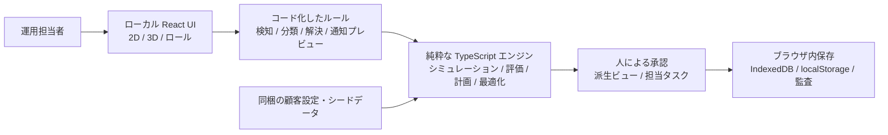

|  |
| --- |
| **アプリケーション要件定義 AI Operations Control Tower** Changi空港のグランドハンドリング業務向けプロトタイプ  スコープ: ユースケース2のみ | ブラウザストレージ型プロトタイプ | 閲覧専用のシミュレーション | 2D/3Dによる運用状況の理解 |

添付のビジネスエンビジョニング資料に基づいています。本書は、そこで示された業務課題を実装可能なプロトタイプ仕様に変換したものであり、追加した設計要件を明示しています。

# 文書の目的

AI Operations Control Tower について、ソフトウェアエンジニアリングのバックログに直接使える要件ベースラインを定義します。運用関係者に一貫した唯一の運用情報源を提供し、例外とオーナーシップを明確に可視化し、非破壊のWhat-ifシミュレーションをサポートし、連携した2Dおよび3Dビューによって空港運用の密な相互関係を理解しやすくします。

# 1. ビジネスコンテキストとスコープ

元資料には、SIOC、BU Ops、Ground Opsにまたがる可視性の分断、トランシーバー/WhatsApp/電話による調整、例外検知の遅れ、アクションオーナーの不明確さ、およびDSM、DCT、G-Ops、Mosaicを並べて監視している実態が記述されています。目指す成果は、フライト、ターンアラウンド、スタッフ、機材、SLAリスクを1つの画面で把握でき、ロールに応じたドリルダウンと説明責任のあるアクション履歴を備えることです。

| **スコープ項目** | **要件ベースライン** |
| --- | --- |
| 主要なビジネスユースケース | AI運用コントロールタワーのみ（ユースケース2）。 |
| 主要ステークホルダー | Control Tower Lead / Head of SIOC（氏名は元資料ではTBCのまま）。 |
| 主要ペルソナ | Control Tower Lead、SIOC Duty Manager、BU Ops Manager、Ramp Lead。プロトタイプのガバナンスのため、OwnerおよびLead stakeholderのレンズを追加。 |
| プロトタイプのストレージ | ブラウザのlocalStorage / IndexedDB。このプロトタイプではバックエンドでの永続化は不要。 |
| 変更ルール | シミュレーターはビューの状態のみを変更する。シミュレーションによってベースライン/ソースデータを上書きしてはならない。 |
| 主要なエクスペリエンス | Microsoftのデザインに着想を得たレスポンシブなダッシュボード。連携した2D/3D探索、ズーム、フィルタリング、ドリルダウン、ロールに応じた情報密度を備える。 |
| スコープ外 | 自律的な実行、運用への書き戻し、実際の空港管制アクション、本番環境のID管理・連携、およびコントロールタワーの全体像を可視化するためにデータエンティティが必要な場合を除くユースケース1、3、4、5。 |

# 2. プロダクト原則

* 運用状況の一元化: すべてのビューは、ブラウザ内の1つのプロトタイプデータモデルと、1つのアクティブなフィルター/シミュレーションコンテキストから導出しなければならない。
* 真実を分断しないロール適合: 各ロールには最適化されたレンズを提供するが、すべてのレンズは同じエンティティID、タイムスタンプ、ステータス、オーナーシップを参照する。
* ビュー優先のプロトタイプ: 操作はフィルター、グループ化、ハイライト、比較、シミュレーションを行ってよいが、ソースとなる運用レコードを変更してはならない。
* 段階的な情報開示: まず全体像を示し、その後、運用コンテキストから離れることなく、ピア/航空会社/フライト/ターンアラウンド/タスク/アセットの詳細を表示する。
* 人が理解できる複雑さ: 2Dと3Dは別々の体験ではなく、同じデータを結び付けて表現したものでなければならない。
* Microsoftのデザイン原則: 明瞭さ、階層、余白、アクセシブルな色のセマンティクス、なじみのあるコマンドパターン、レスポンシブなサーフェス、Fluentスタイルのインタラクション動作。

# 3. ユーザー、ロール、情報レンズ

| **ロール / レンズ** | **主な問い** | **既定の可視範囲** |
| --- | --- | --- |
| Control Tower Lead / Lead stakeholder | 運用リスクはどこに集中しているか。BUをまたぐエスカレーションが必要なものは何か。各例外のオーナーは誰か。 | 空港全体のKPI、例外の重大度、SLA露出度、アクションオーナーシップ、トレンドおよびホットスポットのビュー。 |
| SIOC Duty Manager | 今すぐ介入が必要なフライト/ターンアラウンドはどれか。最新の運用状態はどうか。 | ライブのターンアラウンドボード、フライトマイルストーン、例外キュー、依存関係グラフ、割り当て済みオーナー。 |
| BU Ops Manager | 自分の事業部門、人員、サービスコミットメントに影響するものは何か。 | BUでフィルターしたワークロード、スタッフ/キャパシティ、タスク、フライト、例外、SLAリスク。 |
| Ramp Lead | 自分の担当ピア/スタンドで何が起きており、次に何のアクションが必要か。 | モバイル対応のピア/スタンド/フライトビュー、マイルストーン、タスク、GSEの利用可否、優先度の高い例外。 |
| Action Owner | 自分に何が割り当てられており、その下流の成果は何に依存しているか。 | 自分が所有する例外/タスク、期限/目標時刻、依存関係、ステータス。 |
| Observer / Executive | 編集コントロールなしで運用状況の全体像を把握するには。 | 読み取り専用のサマリー、トレンド、シナリオ比較、2D/3Dの状況ビュー。 |

# 4. 情報アーキテクチャとダッシュボード

|  |  |
| --- | --- |
| **FR-001 単一の運用データソース [Must]** | |
| すべてのダッシュボードコンポーネントは、安定したエンティティIDをキーとする共有のクライアントサイドドメインストアから読み取らなければならない。 | 受け入れ基準: グローバルフィルターを変更すると、表示中のすべてのコンポーネントが一貫して更新される。あるコンポーネントが別のコンポーネントと矛盾するエンティティ状態を表示することはない。 |

|  |  |
| --- | --- |
| **FR-002 ロール対応のダッシュボードシェル [Must]** | |
| アプリケーションは、Control Tower Lead、SIOC Duty Manager、BU Ops Manager、Ramp Lead、Action Owner、Observerのロール/レンズ選択を提供しなければならない。 | 受け入れ基準: ロールを切り替えると、基となるエンティティデータを変更せずに、優先順位付け、レイアウトの強調点、許可されるプロトタイプコントロールが変わる。 |

|  |  |
| --- | --- |
| **FR-003 エグゼクティブKPIストリップ [Must]** | |
| 運用量、リスクのあるフライト、アクティブな例外、SLAリスク、遅延したマイルストーン、利用可能/稼働中のGSE、未完了のオーナーアクションを表示する。 | 受け入れ基準: 各KPIは、そのKPIに寄与している正確なエンティティ集合へのドリルスルーをサポートする。 |

|  |  |
| --- | --- |
| **FR-004 ライブターンアラウンドボード [Must]** | |
| マイルストーンのステータス、リスク、ピア/スタンド、航空会社、オーナー、例外インジケーターを備えた、ソートおよびフィルター可能なフライト/ターンアラウンドボードを提供する。 | 受け入れ基準: ユーザーはBU、ピア、航空会社、重大度、オーナー、時間帯でフィルターし、エンティティの詳細パネルを開くことができる。 |

|  |  |
| --- | --- |
| **FR-005 例外とオーナーシップのキュー [Must]** | |
| 重大度、理由、ソース時刻、影響を受けるエンティティ、オーナー、ステータス、次に想定されるアクションを含む、優先順位付けされた例外キューを提供する。 | 受け入れ基準: 表示されるすべての例外にはオーナー状態（名前付きのオーナー/ロール、または明示的なUnassigned）があり、影響を受けるエンティティへのリンクがある。 |

|  |  |
| --- | --- |
| **FR-006 連携したドリルダウン [Must]** | |
| リスト、KPI、2Dビュー、3Dビューでの選択は、共有の選択コンテキストを更新し、他のすべてのビューを同期しなければならない。 | 受け入れ基準: 1つのフライトを選択すると、アクティブなすべてのパネルで同じフライト、ターンアラウンド、スタンド、タスク、アセット、例外がハイライトされる。 |

|  |  |
| --- | --- |
| **FR-007 Microsoftスタイル UI [Must]** | |
| セマンティックカラー、コマンドバー、サイドパネル、カード、タブ、アクセシブルなフォーカス状態、ツールチップ、レスポンシブな密度を備えた、Fluentに着想を得たビジュアルシステムを使用する。 | 受け入れ基準: コアワークフローはデスクトップおよびタブレットの幅で使用可能であり、ステータスは色だけで伝達されない。 |

# 5. 2D / 3Dによる状況理解

|  |  |
| --- | --- |
| **VIZ-001 2D / 3D切り替え [Must]** | |
| 常時表示のトグルにより、フィルター、選択、時間位置、シミュレーションコンテキストを保持したまま、2D運用マップと3Dシーンを切り替えられなければならない。 | 受け入れ基準: ビューを切り替えても、選択中のフライト/スタンド/例外はリセットされず、ソースレコードも変更されない。 |

|  |  |
| --- | --- |
| **VIZ-002 2D運用ビュー [Must]** | |
| 2Dビューは、パン、ズームイン/アウト、スコープへのフィット、レイヤーの切り替え、クラスタリング、スタンド・フライト・GSE・タスク・例外のセマンティックなハイライトをサポートしなければならない。 | 受け入れ基準: どのズームレベルでも、ユーザーは選択中のエンティティを識別でき、1つのコマンドで空港全体のスコープに戻れる。 |

|  |  |
| --- | --- |
| **VIZ-003 3D運用シーン [Must]** | |
| 3Dビューは、空間的に意味のある空港運用エンティティと、そのステータス/リスクのオーバーレイを、遠距離では制御された簡略化を行いながら描画しなければならない。 | 受け入れ基準: 同じ選択エンティティとステータスカラーが2Dと3Dで認識でき、同期され続ける。 |

|  |  |
| --- | --- |
| **VIZ-004 ダイナミックカメラ [Must]** | |
| 3Dは、オービット、パン、ドリー/ズーム、リセット、選択へのフィット、スタンドへのフォーカス、選択エンティティの追従、および全体表示と詳細表示間のスムーズな遷移をサポートしなければならない。 | 受け入れ基準: カメラコマンドは元に戻せ、アプリケーションの状態を保持し、運用データを一切変更しない。 |

|  |  |
| --- | --- |
| **VIZ-005 複雑さの管理 [Must]** | |
| ユーザーは、フライト、スタンド、ターンアラウンドのマイルストーン、タスク、スタッフ/キャパシティの集計、GSE/アセット、SLAリスク、天候/運用上の制約、例外の関係性のレイヤーを切り替えられなければならない。 | 受け入れ基準: レイヤーの変更は描画にのみ影響する。ユーザーが明示的にデータフィルターを適用しない限り、非表示のエンティティもドメインストアとKPI計算に残る。 |

|  |  |
| --- | --- |
| **VIZ-006 依存関係の可視化 [Must]** | |
| フライト・ターンアラウンド・タスク・アセット・例外・オーナーの関係性を結ぶ、リレーション/依存関係のオーバーレイを提供する。 | 受け入れ基準: 例外を選択すると、レコードを重複させることなく、上流および下流の関連エンティティが表示される。 |

# 6. シミュレーター: 非破壊のWhat-if分析

シミュレーターは、プロトタイプ向けに追加した要件です。元のビジネスレコードとは意図的に分離されています。シナリオは、パラメーターのオーバーライドと、計算された表示上の影響で構成されます。シナリオの適用、リセット、比較は、描画されるビューと導出された指標のみを変更します。

| **シナリオケース** | **有効なプロトタイプパラメーター** | **検証 / 動作** |
| --- | --- | --- |
| 到着便の遅れ | フライトの運航; 遅延分数 0-240; 影響を受けるピア/スタンド; 乗り継ぎ感度 Low/Med/High | 表示されるマイルストーンのタイミング、例外の重大度、SLAリスクのインジケーターのみを再計算する。 |
| 天候 / ランプ作業停止 | 開始オフセット; 継続時間 0-180分; 影響を受けるゾーン; 重大度; 復旧バッファー | 制約ウィンドウと導出された影響をオーバーレイする。ソースとなるフライト/タスクレコードは変更されない。 |
| GSEの欠落 / 利用不可 | アセットタイプ; 利用不可数量 0..利用可能数; 影響を受けるピア/スタンド; 継続時間 | シミュレーション上の利用可否、依存するタスクのリスク、影響を受けるターンアラウンドを更新する。 |
| スタッフキャパシティの低下 | BU/チーム; キャパシティの増減 0-100%; 有効ウィンドウ; 任意のスキルグループ | シミュレーション上のキャパシティ逼迫度と、タスク/マイルストーンのリスクを更新する。 |
| SLA閾値ストレス | 航空会社; SLAマイルストーン; 閾値の増減; 選択したフライト/時間帯 | ビュー比較のため、シミュレーション上のSLAリスク分類を再計算する。 |
| 複合的な障害 | 上記の互換性のある任意の組み合わせに、シナリオ名とメモを付与 | 競合の検証、シナリオサマリー、影響を受けるエンティティ数、ベースライン対シナリオのビューを表示する。 |

|  |  |
| --- | --- |
| **SIM-001 シナリオの分離 [Must]** | |
| シミュレーターの各実行は、ベースラインのエンティティとは別のシナリオオブジェクトとして保存しなければならない。 | 受け入れ基準: シナリオ適用後にベースラインデータを確認すると、プロトタイプのUIメタデータを除き、ビジネスエンティティの値がバイト単位で同等である。 |

|  |  |
| --- | --- |
| **SIM-002 パラメーターの検証 [Must]** | |
| シミュレーターのコントロールは、シナリオを適用する前に、範囲、型、必須スコープ、パラメーター間の互換性を強制しなければならない。 | 受け入れ基準: 無効または矛盾するパラメーターは、目に見える検証メッセージを生成し、アクティブなビューを変更しない。 |

|  |  |
| --- | --- |
| **SIM-003 ベースライン比較 [Must]** | |
| Baseline / Scenario / Differenceのモードを提供する。 | 受け入れ基準: ユーザーは、どの指標/エンティティが異なるかを識別でき、1回の操作でBaselineに戻れる。 |

|  |  |
| --- | --- |
| **SIM-004 シナリオのライフサイクル [Must]** | |
| ユーザーは、ブラウザストレージ上のプロトタイプシナリオを、作成、複製、名前変更、有効化、無効化、削除できる。 | 受け入れ基準: シナリオを削除しても、ベースラインの運用エンティティが削除されることはない。 |

# 7. ビジネスエンティティのカバレッジ

元のユースケースは、フライト、ターンアラウンド、スタッフ、機材、SLAリスク、例外、BU/ピア/航空会社でのドリルダウン、アクション可能なオーナーシップを明示的に求めています。以下のプロトタイプドメインモデルは、これらを正規化したUIエンティティに展開し、コントロールタワーのすべての概念がアドレス可能なレコードを持つようにします。

| **エンティティ** | **最小フィールド** | **主なリレーション** |
| --- | --- | --- |
| FlightOccurrence | id, flightNo, airlineId, origin/destination, STD/STA/ETD/ETA/ATA, status, pierId, standId | 1:1/1:n Turnaround; Airline; Stand; Exceptions |
| Turnaround | id, flightId, planned/actual window, phase, health, SLA risk | Flight; Milestones; Tasks; Assets; Exceptions |
| Milestone | id, turnaroundId, type, plannedTime, actual/forecastTime, status | Turnaround; Tasks; SLA |
| Task | id, turnaroundId, taskType, ownerId/role, status, planned/forecast/actual times, priority | Turnaround; Owner; Asset; Exception |
| StaffCapacity | id, BU/team, skillGroup, planned, available, engaged, window | BU; Tasks; Exceptions |
| Asset / GSE | id, type, status, location, assignment, availability window | Task; Turnaround; Stand; Exception |
| Stand / Pier | id, pier, stand, coordinates2D, coordinates3D, status | Flights; Turnarounds; Assets; Exceptions |
| Airline | id, code, name, SLA profile id | Flights; SLA Rules |
| SLARule | id, airlineId, milestone/task scope, target, tolerance, priority | Airline; Milestone; SLARisk |
| SLARisk | id, ruleId, affectedEntityId, level, cause, forecast breach time | SLA Rule; Flight/Turnaround/Task; Exception |
| Exception | id, type, severity, detectedAt, source, status, ownerId/role, affectedEntityIds, explanation | 任意の運用エンティティ; Owner; Action |
| Action / Ownership | id, exceptionId/taskId, owner, leadStakeholder, status, targetTime, audit entries | Exception/Task; Role; Stakeholder |
| BusinessUnit | id, name, operational scope | Staff; Owners; Tasks; filters |
| Role / Stakeholder | id, displayName, roleType, BU, responsibility scope | Actions; Exceptions; dashboard lens |
| Weather / Constraint | id, type, scope, start/end, severity, source timestamp | Stand/Pier; Flight; Task; Simulation |
| Scenario | id, name, parameters, createdAt, active, derivedImpact | ベースラインエンティティを参照する。所有・変更は決してしない |
| Audit / Interaction Event | id, time, actor/lens, action, entityRef, scenarioRef | プロトタイプのユーザー操作とシナリオ変更を追跡する |

# 8. データとブラウザストレージの設計

|  |  |
| --- | --- |
| **DATA-001 プロトタイプのシードデータ [Must]** | |
| アプリケーションは、すべてのドメインエンティティとサポートするすべてのリスク状態をカバーする、添付資料由来または合成のプロトタイプデータセットを読み込まなければならない。 | 受け入れ基準: 新しいブラウザプロファイルでプロトタイプを初期化でき、外部サービスなしで代表的なエンティティを表示できる。 |

|  |  |
| --- | --- |
| **DATA-002 ブラウザでの永続化 [Must]** | |
| エンティティ/シナリオのコレクションにはIndexedDBを使用し、選択中のロール、テーマ、アクティブなビュー、パネルレイアウトなどの小さなUI設定にのみlocalStorageを使用する。 | 受け入れ基準: 更新/再オープンでプロトタイプの状態が復元される。localStorageのような小さな値の上限を超えても、エンティティの永続化は壊れない。 |

|  |  |
| --- | --- |
| **DATA-003 読み取り専用のベースラインレコード [Must]** | |
| ベースラインのエンティティストアは、UI機能に対して不変/読み取り専用のアプリケーションオブジェクトを公開しなければならない。 | 受け入れ基準: シミュレーターや可視化の操作によってベースラインレコードを編集することはできない。 |

|  |  |
| --- | --- |
| **DATA-004 スキーマのバージョニング [Must]** | |
| 保存データにはschemaVersionとseedVersionを含め、明示的なマイグレーション/リセットの経路を備えなければならない。 | 受け入れ基準: スキーマの不一致が検出され、暗黙のデータ破損なく処理される。 |

|  |  |
| --- | --- |
| **DATA-005 リセットとエクスポート [Must]** | |
| Reset PrototypeおよびExport Scenario/Diagnosticsのアクションを提供する。 | 受け入れ基準: Resetでシードのベースラインが復元される。エクスポートにはシークレットが含まれず、ベースラインの識別子とシナリオのオーバーライドが明確に分離される。 |

# 9. 詳細なビューとインタラクション

| **ビュー** | **必須の内容** |
| --- | --- |
| Operations overview | KPIストリップ、空港の2D/3Dペイン、例外の優先度リスト、ピア/航空会社別のリスク、アクティブなシナリオバナー、オーナーシップのサマリー。 |
| Turnaround workspace | フライトヘッダー、マイルストーンのタイムライン、タスク、割り当て済みGSE、スタッフキャパシティのインジケーター、SLAリスク、関連する例外、オーナーの履歴。 |
| Exception detail | 重大度、検知時刻/ソース、影響を受けるエンティティ、依存関係チェーン、オーナー/Lead stakeholder、経過時間/目標時刻、現在およびシミュレーション上の影響。 |
| Owner workbench | オーナー/ロール別にグループ化した項目、BUをまたぐ依存関係、期限/目標ウィンドウ、ステータスと影響。 |
| Scenario manager | シナリオ一覧、パラメーターエディター、検証、適用/リセット、baseline/scenario/differenceの比較、影響を受けるエンティティのエクスプローラー。 |
| 3D focus mode | 選択したピア/スタンド/フライトのコンテキスト、レイヤーコントロール、カメラコントロール、ラベル/タグ、リスク凡例、ミニサマリーパネル。 |

# 10. 非機能要件

|  |  |
| --- | --- |
| **NFR-001 パフォーマンス [Must]** | |
| 一般的なフィルター、選択の変更、ロールの切り替えは、ページ全体を再読み込みせずにインタラクティブに更新されるべきである。密度の高いシーンでは、ビューポート/レイヤーの簡略化を用いて描画しなければならない。 | 受け入れ基準: プロトタイプのテストデータセットが、高速なパン/ズーム、ビューの切り替え、フィルター操作の間も使用可能である。 |

|  |  |
| --- | --- |
| **NFR-002 アクセシビリティ [Must]** | |
| キーボードナビゲーション、可視のフォーカス、セマンティックなラベル、十分なコントラスト、ステータスの代替テキスト、モーション低減の設定、色に依存しないリスク表現をサポートする。 | 受け入れ基準: 重要なダッシュボードおよびシミュレーターのワークフローが、マウス専用のジェスチャーなしで操作できる。 |

|  |  |
| --- | --- |
| **NFR-003 レスポンシブデザイン [Must]** | |
| コントロールルーム向けデスクトップ、標準的なノートPC/タブレット、コンパクトなRamp Lead向けレイアウトをサポートする。 | 受け入れ基準: サポートされるブレークポイントで、主要なアクションや重要なステータスにアクセスできなくなることがない。 |

|  |  |
| --- | --- |
| **NFR-004 説明可能性 [Must]** | |
| 導出されたすべてのリスクまたはシミュレーション上の変更は、寄与要因/パラメーターを示し、BaselineかSimulatedかを明示しなければならない。 | 受け入れ基準: ユーザーは、観測値/ソース値とプロトタイプで導出された計算値を常に区別できる。 |

|  |  |
| --- | --- |
| **NFR-005 安全境界 [Must]** | |
| プロトタイプには、実際の空港での実行やデータの書き戻しを表すコントロールを一切含めてはならない。 | 受け入れ基準: すべてのシナリオアクションにはシミュレーション/閲覧専用と表示され、ネットワーク経由の変更エンドポイントは不要である。 |

|  |  |
| --- | --- |
| **NFR-006 可観測性 [Must]** | |
| 機微な運用ペイロードを含めずに、読み込み、描画エラー、無効なシナリオパラメーター、操作タイミングに関するクライアントサイドの診断情報を取得する。 | 受け入れ基準: プロトタイプのトラブルシューティングのため、診断情報をエクスポートできる。 |

# 11. 状態モデル

| **状態ファミリー** | **許可される状態** |
| --- | --- |
| Flight | Scheduled, Inbound, Arrived, Turnaround, Ready, Departed, Delayed, Cancelled |
| Turnaround | NotStarted, Active, AtRisk, Blocked, Complete |
| Milestone / Task | Planned, Ready, InProgress, AtRisk, Blocked, Complete |
| Asset | Available, Reserved, Engaged, Unavailable, Unknown |
| Exception | New, Acknowledged, Assigned, Monitoring, Resolved |
| SLA risk | Normal, Watch, AtRisk, Breach |
| Scenario | Draft, Valid, Active, Inactive |

これらのプロトタイプ状態は、エンジニアリング上の正規化として提案するものであり、既存のSATS/Changiのシステムの列挙値について主張するものではありません。本番環境のディスカバリー時に、実際のソースシステムのコードへマッピングする必要があります。

# 12. 受け入れシナリオ

| **ID** | **Given / When / Then** |
| --- | --- |
| AT-01 | 空港全体のオーバービューがある状態で、Lead stakeholderがRamp Leadに切り替えたとき、基となるレコードは同じままアクティブであり、ビューは選択したランプのスコープと所有するアクションを強調する。 |
| AT-02 | ターンアラウンドボードでフライトを選択した状態で、ユーザーが2Dから3Dに切り替えたとき、同じフライト、スタンド、ターンアラウンド、関連する例外が選択されたまま表示される。 |
| AT-03 | 45分の到着便遅れのシミュレーターシナリオがある状態で、Applyを選択したとき、リスク/マイルストーンのインジケーターがScenarioモードで更新され、ベースラインのエンティティのタイムスタンプは変更されない。 |
| AT-04 | 無効な停止継続時間または利用不可アセット数量がある状態で、Applyを選択したとき、検証メッセージが表示され、アクティブなシナリオ/ビューは変更されない。 |
| AT-05 | 複数のアクティブな例外がある状態で、Ownerでフィルターしたとき、KPI、リスト、マップ、3Dシーンが同じフィルター済みエンティティ集合に解決される。 |
| AT-06 | 密度の高い3Dコンテンツがある状態で、ユーザーが空港レベルからスタンドレベルまでズームしたとき、ラベル/レイヤーが段階的に詳細を開示し、ダイナミックカメラで全体表示にリセットできる。 |
| AT-07 | シナリオが削除された状態で、Baselineを開き直したとき、シードされたすべてのベースラインエンティティと値が損なわれていない。 |

# 13. プロトタイプのコンポーネントアーキテクチャ

**現在の構成: ローカル専用・ルールベースのデモ。** 過去の Azure / LLM 構成図より本節を優先します。水平構成は以下の左から右への配置を意味し、クラウドのスケールアウトではありません。

| **ID** | **要件・受け入れ条件** |
| --- | --- |
| DEMO-001 | 依存関係の導入後、シナリオ、2D/3D、計画、最適化、GPS 再生、タスク、価値計算、エクスポートの全機能が localhost のみで動作する。Azure、外部 API、モデルのダウンロードは不要。 |
| DEMO-002 | 推薦はコード化した決定論的ルールのみ。同一入力には同一の有効な選択肢・KPI 差分を返す。旧 API URL 設定で外部通信は有効にならない。 |
| DEMO-003 | Control Tower Lead、SIOC Duty Manager、BU Ops Manager の明示的な承認前に決定を適用しない。決定と監査をローカル保存し、ベースラインは変更しない。 |
| DEMO-004 | Azure デプロイ自動化は無効。過去のインフラ・サービスは参考資料であり、現在のデモから呼び出さない。 |

全コンポーネントは発表者の端末内で動作します。Node/Vite はローカルの静的アセットを配信するだけです。LLM、バックエンド、Teams 送信は使用しません。GPS と業務フィードはローカルでシミュレーションします。ロール選択はデモ用で、本番認証の代わりにはなりません。

* Webアプリケーションシェル: プロトタイプUIにはReact/TypeScriptを推奨。コンポーネントライブラリはFluentスタイルのパターンに従うこと。
* ドメインストア: IndexedDBからハイドレートされる正規化されたインメモリ状態。セレクターがロール/フィルター/シナリオごとの射影を生成する。
* シナリオエンジン: ベースラインのスナップショットと検証済みパラメーターを受け取り、導出された影響オーバーレイを返す純粋関数。
* 2Dレンダラー: レイヤーと安定したエンティティのヒットテストを備えた、ベクター/キャンバス/WebGLのマップ抽象化。
* 3Dレンダラー: エンティティからシーンへのマッピング、詳細度(LOD)、ラベル/タグ、カメラコントローラーを備えた、WebGLシーンの抽象化。
* 永続化: ベースラインのシードキャッシュ、シナリオ、診断イベントにはIndexedDBリポジトリを使用し、軽量な設定にはlocalStorageを使用する。
* 本番サービスへの依存なし: 将来のリアルタイムソースがプレゼンテーションロジックを書き換えずにシードプロバイダーを置き換えられるよう、ネットワークアダプターはインターフェースの背後に置くこと。

# 14. 添付のビジネス資料へのトレーサビリティ

| **元資料のビジネス上の記述** | **要件によるカバレッジ** |
| --- | --- |
| SIOC、BU Ops、Ground Opsはそれぞれ全体像の一部しか見ていない | FR-001、FR-002、FR-006、連携した2D/3Dの単一データソース。 |
| 例外の発見が遅く、手作業でエスカレーションされている | FR-003、FR-005、例外の詳細、オーナーシップとリスクの可視化。 |
| 計画が変わったときに、誰が何をすべきかが常に明確とは限らない | Role/Stakeholder、Action/Ownership、オーナーワークベンチ、例外キュー。 |
| フライト、ターンアラウンド、スタッフ、機材、SLAリスクを示す単一画面 | エンティティモデルに加え、オペレーションオーバービューとターンアラウンドワークスペース。 |
| BU、ピア、航空会社別のドリルダウン。Ramp Lead向けのモバイルビュー | FR-004、ロールレンズ、レスポンシブなNFR-003。 |
| 優先度の高い例外を、1つのフローでクローズまで追跡する | 例外/アクションの状態、オーナーシップキュー、監査エンティティ。 |
| ユーザー追加要件: シミュレーターは閲覧専用 | SIM-001..004、DATA-003、NFR-005。 |
| ユーザー追加要件: ズームとダイナミックカメラを備えた2D/3D | VIZ-001..006。 |

# 15. 本番ディスカバリーでの課題 / 決定事項

* 実際のSATS/Changiのソースインターフェース、ソースシステムの識別子、イベントスキーマ、鮮度/レイテンシーの契約を確認する。
* 権威ある役割/責任マトリクスと、Control Tower Lead / オーナーの氏名の割り当てを確認する。
* 2D/3Dでの使用が許可される実際の空港空間モデル、座標系、マップ/3Dアセットの権利、制限区域のセキュリティ上の制約を確認する。
* 正確なSLA定義と航空会社固有のマイルストーンルールを確認する。元資料では一部の目標値がTBCのままである。
* 本番環境のID管理、認可、保持、監査、プライバシーの要件を確認する。ブラウザストレージはプロトタイピング専用である。
* 本番の3Dレンダリングスタックを確定する前に、パフォーマンス目標と代表的なピーク時のエンティティ数を確認する。

# 16. 本プロトタイプの完了の定義

* セクション7のすべてのエンティティタイプが投入され、UI上で参照できる。
* セクション3のすべてのロールレンズを、単一のデータストアからデモできる。
* 2Dと3Dのビューが同期し、選択、レイヤー制御、ズームをサポートする。3Dはダイナミックカメラ制御をサポートする。
* セクション6のシミュレーターの少なくとも5つのケースでパラメーターを検証し、非破壊のBaseline/Scenario/Differenceビューを生成する。
* シミュレーターの操作順序、ページの更新、シナリオの削除の後でも、ベースラインレコードは変更されない。
* 重要なワークフローがアクセシビリティおよびレスポンシブの要件を満たす。
* 表示されるすべてのシミュレーション/導出値が明示的にラベル付けされ、そのパラメーターまで追跡できる。

# 17. リソースとタスクの最適化（オートパイロット）

元のセクションには最適化機能がありませんでした。シミュレーターはWhat-ifの影響を分析するだけであり、意思決定キューは緩和策を提案するだけです。本セクションでは、空港リソースの再計画を推奨するワンクリックのオプティマイザーを追加します。これは推奨エンジンにすぎません。閲覧専用であり、ベースラインレコードを編集せず、運用への書き戻しも行いません（DATA-003、NFR-005）。

| **優先度 / 制約** | **使用方法** | **プロトタイプの動作** |
| --- | --- | --- |
| SLA / 航空会社の優先度 | 重み | ターンアラウンドのSLAリスク、航空会社のSLAティア、未解決の例外の重大度でフライトをランク付けする。 |
| 時間的な切迫度 | 重み + ハード制約 | 出発が早いものほど上位にランク付けする。計画ホライズン（ローリングウィンドウ）が問題の範囲を限定する。すでにスタンドにいる航空機は固定される。 |
| 場所の距離 | 重み + ハード制約 | 利用可能な機材プールに近いスタンドを優先する。最大移動距離の範囲内で、最も近い空きGSEを割り当てる。 |
| リソースの制約 | 重み + ハード制約 | GSE 1台につき同時に1タスクのみ。余裕のあるスキルプールから過負荷のスキルプールへ要員を移動する。スタンド変更を少なくする（再ゲーティングのペナルティ）。 |
| ゲート要員の枠 | ハード制約 | 1スタンドあたり同時に実行するサービスタスクは最大N件。超過したタスクは時間をずらす。 |
| ターンアラウンドバッファー / 閉鎖 / 天候 | ハード制約 | バッファーを含めてスタンドの重複を認めない。閉鎖されたスタンドや天候の制約を受けるピアは避ける。 |

|  |  |
| --- | --- |
| **OPT-001 ワンクリック最適化 [Must]** | |
| Optimizeタブは、スタンド、GSEの割り当て、要員プール間の移動、要員枠の時間ずらしをまとめて計画する、単一の「Optimize all」アクションを提供しなければならない。 | 受け入れ基準: 1回のクリックで追加入力なしに計画が生成される。同じデータで2回実行すると同じ計画になる。 |

|  |  |
| --- | --- |
| **OPT-002 設定可能な優先度と制約 [Must]** | |
| ユーザーは、プリセット（Balanced、SLA first、Resource saving、Time critical）を選択するか、SLA・距離・時間・リソースの重み（0-10）を調整し、ホライズン、スタンドバッファー、GSEの最大移動距離、スタンドあたりの要員枠を設定できなければならない。 | 受け入れ基準: 重みや制約を変更すると古い計画はクリアされる。生成された計画で制約が違反されることはない。 |

|  |  |
| --- | --- |
| **OPT-003 説明可能な結果 [Must]** | |
| 計画には、前後の指標（スタンドの重複、未割り当てのGSEタスク、GSEの移動距離、過負荷の要員プール、枠の超過、重み付きコスト）、個々の変更とその理由、および解決できなかった項目を表示しなければならない。 | 受け入れ基準: すべての移動、割り当て、移管、シフトが一覧表示される。未解決の項目はブロックしている制約を明記し、人の判断に委ねられる。 |

|  |  |
| --- | --- |
| **OPT-004 非破壊かつ監査可能 [Must]** | |
| オプティマイザーは、アクティブなシナリオビュー（シミュレーション上の遅延、閉鎖、キャパシティ）を尊重し、出力を導出されたものとして示し、実行ごとに監査エントリを書き込まなければならない。 | 受け入れ基準: 実行後もベースラインのエンティティはバイト単位で同等である（AT-08）。 |

最適化アプローチ（実務に沿ったもの）: 優先度順のグリーディヒューリスティックで、ローリングホライズンと固定ウィンドウ、連続するスタンド使用間のターンアラウンドバッファー、近接性を考慮した時間ウィンドウスケジューリングとしてのGSE割り当て、スキルプールの平準化、要員枠の制約を用います。本番環境では、同じインターフェースの背後で、このヒューリスティックを厳密解法またはメタヒューリスティックのソルバー（MIP/CP-SAT）に置き換えます。参考資料: [A Complete Guide on Airport Operations Optimization](https://www.bqpsim.com/articles/airport-operations-optimization)、[Optimizing Airport Gate Assignments: Methods & Metrics](https://www.bqpsim.com/quantum-optimization/airport-gate-optimization)、[A Bi-Objective Optimization Model for Integrated Gate Assignment and ...](https://www.mdpi.com/2673-7590/6/2/86)、[Improving Robustness through Buffer Placement in the Gate Assignment Problem](https://www.mit.edu/~hamsa/pubs/ZimmerBalakrishnanOdoni-ICRAT2024-final.pdf)、[The Airport Gate Assignment Problem (Lim et al.)](https://www.researchgate.net/profile/Andrew-Lim-16/publication/2919193_The_Airport_Gate_Assignment_Problem/links/00b495298b538ba93a000000/The-Airport-Gate-Assignment-Problem.pdf)。

| **ID** | **Given / When / Then** |
| --- | --- |
| AT-08 | ライブのベースラインまたは任意のアクティブなシナリオがある状態で、ユーザーがOptimize allを選択したとき、前後の指標を含む計画が表示され、制約の超過はなく、未解決の項目にフラグが付き、ベースラインのエンティティの値は変更されない。 |

# 18. リソース計画（日 / 週のスケジュール）

|  |  |
| --- | --- |
| **PLAN-001 日次・週次のリソーススケジュール [Must]** | |
| Planningタブは、選択した1日または1週間全体について、各リソース（ゲート、スタッフチームとシフト、GSEユニット、手荷物ベルト、チェックインカウンター列）が何に割り当てられているかを、ガントチャートとテーブルで表示しなければならない。 | 受け入れ基準: Day/WeekおよびGantt/Tableを切り替えても同じフィルターが維持される。各行にはキャパシティ数、稼働率、競合が表示される。 |

|  |  |
| --- | --- |
| **PLAN-002 フィルター、ドリルダウン、競合 [Must]** | |
| ユーザーは、リソースタイプ、ターミナル、フリーテキスト検索でフィルターし、任意のバーを開いてその詳細を確認でき、重複した予約やキャパシティ超過の負荷にフラグが付けられる。 | 受け入れ基準: ダブルブッキングされたゲートは両方のビューでハイライトされ、競合の合計数にカウントされる。 |

|  |  |
| --- | --- |
| **PLAN-003 ロスターフィードがない場合のサンプルデータ [Should]** | |
| 実際のロスター/AODBフィードがない場合、プロトタイプは、Changiをモデルにした決定論的なサンプルの1週間分（4つのターミナル、約100のゲート、3シフトのSATS / dnata方式のグランドハンドリング、1日あたり約1,000の運航）を生成しなければならない。 | 受け入れ基準: データにはシミュレーションと表示され、新しいプロファイルでは毎回同一である。出典: [Singapore Changi Airport (SIN) terminal map](https://worldairportmap.com/airport/SIN)、[Infrastructure of Changi Airport](https://en.wikipedia.org/wiki/Infrastructure_of_Changi_Airport)。 |

# 19. 言語切り替え

|  |  |
| --- | --- |
| **I18N-001 4言語UI [Must]** | |
| ヘッダーのトグルにより、ラベル、ツールチップ、メッセージ、テーブル、チャート、2D/3Dラベル、生成される説明文（シード、デモ、オプティマイザー、計画のテキスト）を含むUI全体を、英語、中国語（簡体字）、韓国語、日本語の間で切り替えられなければならない。 | 受け入れ基準: 言語を切り替えても、選択、フィルター、シナリオの状態を失うことなく、表示されるすべてのテキストが変わる。選択は再読み込み後も保持される。翻訳がない場合は英語にフォールバックする。 |

# 20. GPSトラッキングマップ

|  |  |
| --- | --- |
| **GPS-001 5分ごとのエンティティ追跡 [Must]** | |
| Situationalビューは、航空機（ADS-B / A-SMGCS）、GSE車両（車両テレマティクス）、スタッフ（ハンドヘルドGNSS、屋内のBLE / Wi-Fi）を、運用上の5分ごとにエンティティあたり1回の位置情報（緯度、経度、階層、速度、方位、精度、ソース、状態）で追跡するGPSモードを提供しなければならない。 | 受け入れ基準: 運用時間の5分ごとに新しい位置情報が表示される。各位置情報はIndexedDBに保存され、CSVとしてエクスポートできる。 |

|  |  |
| --- | --- |
| **GPS-002 マップレイヤー [Must]** | |
| ユーザーは、Overview、Apron / airside、Level 1 arrivals、Level 2 departures、Level 3 transit / gatesのいずれかのマップレイヤーを選択できる。選択した階層にあるエンティティのみが表示される。Go-toセレクターで、Terminal 1-4またはJewelにジャンプできる。マップのレイアウトは公開されているChangiのマップに従い（T3が北、T2が南側に2本のピア、T1が東で角度のついたピア、中央にJewel、T4が南西）、ゲートは公開マップと同じ表記（例: D30）でラベル付けされる。 | 受け入れ基準: レイヤーを切り替えると、フロアの要素（ベルト、チェックインカウンター列、ゲートラウンジ、スタンド）と表示されるエンティティが変わる。 |

|  |  |
| --- | --- |
| **GPS-003 Googleマップ風のナビゲーション [Must]** | |
| マップは、カーソル位置を中心としたホイール/トラックパッドでのズーム、ドラッグによるパン、ピンチズーム、ダブルクリックズーム、+/-ボタン、リセット、選択へのズーム、キーボード操作、スケールバー、カーソル座標をサポートし、ズームインに応じてラベルが表示されなければならない。 | 受け入れ基準: ズームしてもカーソル下の点が固定されたままであり、ズームはオーバービューからスタンドレベルの範囲に制限される。 |

|  |  |
| --- | --- |
| **GPS-004 履歴とリプレイ [Should]** | |
| ユーザーは、タイムスライダーで直近3時間の位置情報をリプレイし、移動の軌跡を確認し、エンティティを検索して追従できなければならない。 | 受け入れ基準: リプレイでは、選択した時刻以前の最後の位置情報の位置に各エンティティが表示される。Liveに戻すと最新の位置情報に戻る。 |

マップのジオメトリは、公開されている[Changi Airport map](https://www.changiairport.com/en/at-changi/map.html)（ターミナルT1-T4、Jewel、エプロン、滑走路）を模式的に表したものであり、測量に基づくものではありません。本番環境では、公式のフロアプラン/GeoJSONと実際の測位フィードを読み込みます。

# 21. データ分析ビュー

「Analytics」タブは、探索的データ分析（EDA）のベストプラクティスをベースライン全体に適用します。各変数の要約、分布と外れ値の確認、グループ比較、関係性の検証、データ品質の確認を行い、すべての数値をチャートに対応付けます。参照したガイダンス：Tukey 流 EDA（五数要約、1.5×IQR の外れ値フェンス。[Wikipedia: Exploratory data analysis](https://en.wikipedia.org/wiki/Exploratory_data_analysis)）、アクセシブルなレポート設計（[Microsoft Learn: Power BI レポートのアクセシビリティ設計](https://learn.microsoft.com/en-us/power-bi/create-reports/desktop-accessibility-creating-reports)）。

|  |  |
| --- | --- |
| **ANA-001 ベースライン全体の探索的チャート [Must]** | |
| Analytics タブは、全タスク・例外・要員を対象に D3.js のチャートを描画する：タスク遅延予測のヒストグラム、事業部別遅延の箱ひげ図、計画時刻と遅延の散布図（線形トレンド付き）、例外の種別×重大度ヒートマップ、計画／稼働可能／従事中要員の棒グラフ。 | 受入基準：読み込み時にチャートがアニメーションする（動きを減らす設定では無効）。計算は `app/src/domain/analytics.ts` の純粋関数で行う。 |

|  |  |
| --- | --- |
| **ANA-002 リンクされたブラッシング [Must]** | |
| ヒストグラム上のドラッグで遅延範囲を選択すると、主な発見、箱ひげ図、散布図、要約表が選択したタスクに更新される。「選択を解除」ボタンで全件に戻る。 | 受入基準：選択件数と統計量が範囲内のタスクと一致し、解除で元の数値に戻る。 |

|  |  |
| --- | --- |
| **ANA-003 統計要約と主な発見 [Must]** | |
| 事業部ごとの n、平均、中央値、Q1、Q3、外れ値数、計画時刻と遅延のピアソン相関、平易な文章の主な発見を表示する。 | 受入基準：同一入力で結果が決定的であり、空の選択でも定義される。 |

|  |  |
| --- | --- |
| **ANA-004 データ品質プロファイル [Should]** | |
| エンティティ（フライト、ターンアラウンド、タスク、例外、資産）ごとにレコード数、欠損、完全性を報告する。 | 受入基準：完全性は 0〜100% で、90% 未満は記号とテキストで示す。 |

|  |  |
| --- | --- |
| **ANA-005 アクセシブルな可視化 [Must]** | |
| すべてのチャートにテキストラベル、ツールチップ、表またはテキストの代替を備え、色だけに依存しない（マーカー形状、数値表示、記号）。すべての文言は `tr()` で en / zh / ko / ja に対応する。 | 受入基準：Playwright がタブとブラッシング操作を検証し、i18n テストが通る。 |

# 22. 空港インポーター

ヘッダーの「空港をインポート」から、同梱の世界各地の空港カタログ（各大陸の主要国際空港、実装は `app/src/importer/`）の任意の空港にプロトタイプを切り替えられる。公開データをWikipedia / Wikidataから収集し、有効なサンプルデータを決定的に生成してブラウザに保存する。

|  |  |
| --- | --- |
| **IMP-001 ローカライズされた名称で世界の空港を選択 [Must]** | |
| 検索可能な一覧から空港を選択する。各項目は現在のUI言語（en / zh / ko / ja）の名称、IATA / ICAOコード、国、IANAタイムゾーンを表示し、検索は任意の言語・IATA・ICAOに一致する。 | 受け入れ基準: すべてのカタログ空港が4言語の名称と有効なIANAタイムゾーンを持ち、日本語名での検索で空港が見つかる。 |

|  |  |
| --- | --- |
| **IMP-002 インターネットから関連データを収集 [Must]** | |
| Wikipedia記事、各言語（en / zh / ko / ja）の概要、Wikidataの事実（年間旅客数、標高、Webサイト、開港年）を収集する。ネットワークが使えない場合もカタログデータで続行し、それを理由に失敗しない。 | 受け入れ基準: モックしたfetcherでのパース（オフラインの場合を含む）が単体テストでカバーされる。 |

|  |  |
| --- | --- |
| **IMP-003 有効なサンプルデータの生成 [Must]** | |
| 収集した事実から、有効な顧客プロファイル（`validateCustomer`で検証）と、旅客数に応じた規模の航空会社・スタンド・フライト・要員キャパシティを生成する。生成は決定的（IATAコードをシードとし`Math.random`は使わない）で、生成した前提値は仮定として明示する。 | 受け入れ基準: 同一入力は同一出力となり、すべてのフライトが既存のスタンドを参照する。 |

|  |  |
| --- | --- |
| **IMP-004 すべてのデータを保存 [Must]** | |
| 収集した事実、カタログレコード、顧客プロファイル、生成データセットをIndexedDBの`airports`ストアに保存する。顧客プロファイルはローカルストレージにも複製し、再読み込み後にインポートした空港がアクティブな顧客になる（`?customer=`と`VITE_CUSTOMER`が引き続き優先）。 | 受け入れ基準: インポートした空港は再読み込み後も残り、IndexedDBから一覧できる。 |

|  |  |
| --- | --- |
| **IMP-005 プログレスバーと画面の暗転 [Must]** | |
| インポート中は、動くストライプのアニメーション付きプログレスバー、パーセンテージ、現在のフェーズ（記事検索、事実収集、ローカライズ説明、生成、検証、保存、有効化）をモーダルで表示する。完了または失敗までそれ以外の画面は暗転し操作できない。視覚効果の低減設定ではアニメーションを止める。すべての文言は`tr()`を通す。 | 受け入れ基準: プログレスバーは0〜100の値を持つ`role="progressbar"`を公開し、暗転レイヤーが操作を妨げ、完了時は再読み込み、失敗時はエラーを表示する。 |

|  |  |
| --- | --- |
| **IMP-006 実地図データ [Must]** | |
| インターネットを検索し、OpenStreetMapからOverpass API（複数の公開エンドポイントを順に試行）で実際の空港ジオメトリ（滑走路、誘導路、エプロン、ターミナル）を取得して空港とともに保存し、インポートした空港の2D状況ビューに描画する。地図にはOpenStreetMap / ODblのクレジットを表示する。すべてのエンドポイントに接続できない場合はチャンギの模式図のままとする。 | 受け入れ基準: Overpassのパースと投影が単体テストされ、再読み込み後に保存済みの地図が描画される。 |

|  |  |
| --- | --- |
| **IMP-007 画面上部に空港名を表示 [Must]** | |
| ヘッダーの製品タイトルの下に、現在の空港名（UI言語に合わせた表記）とIATAコードを表示する。 | 受け入れ基準: UIが日本語の状態で東京国際空港（羽田）をインポートすると、ヘッダーに「東京国際空港（羽田） (HND)」と表示される。 |

|  |  |
| --- | --- |
| **IMP-008 空港のタイムゾーン [Must]** | |
| 運用時計、エンジンが使う1日の分数、ログのタイムスタンプは、空港のIANAタイムゾーン（`customer.json`の`airport.timezone`）を使用し、時計のラベルには空港名とUTCオフセットを表示する。 | 受け入れ基準: 羽田がアクティブのとき、時計は日本時間（GMT+9）を表示する。 |

|  |  |
| --- | --- |
| **IMP-009 空港の国に合わせたUI言語 [Should]** | |
| インポート後、UI言語をその国の言語に切り替える（JP: 日本語、KR: 韓国語、CN / HK / TW / MO: 中国語）。それ以外の国（翻訳なし）は英語とする。その後はユーザーが言語を変更できる。 | 受け入れ基準: 国から言語へのマッピングを単体テストし、英語がフォールバックとなる。 |

制約: 運用ベースライン（フライトボード、2D / 3Dマップ）は引き続きチャンギのシードから生成される。インポートした空港は顧客固有のビュー（価値モデル、エグゼクティブ向け資料、名称）を駆動し、生成データセットは今後の連携のために保存される。

# 付録A - 情報源の根拠

主要な参照元: SATS Project SPEAR - Business Envisioning Output.pptx（特にスライド3、4、7、8、15-17）。補足的なアーキテクチャの参照元: SkyFlowAI\_Solution\_Envisioning\_EN.pptx（特に、読み取り専用のエビデンス、連携したデータモデル、権限、状態、信頼性、人によるコントロールの各概念）。ブラウザのみでの永続化、詳細なシミュレーターのパラメーター範囲、正規化されたプロトタイプの状態列挙、2D/3Dのカメラ動作など、これらの資料に明示されていない要件は、要求されたプロトタイプの範囲を満たすために追加した設計提案です。
